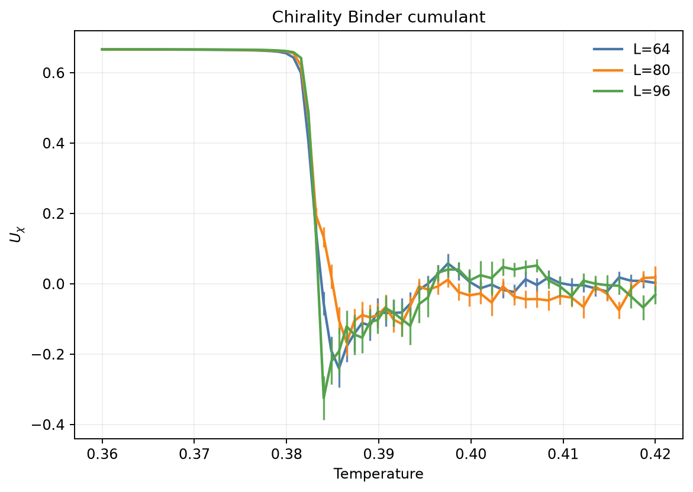
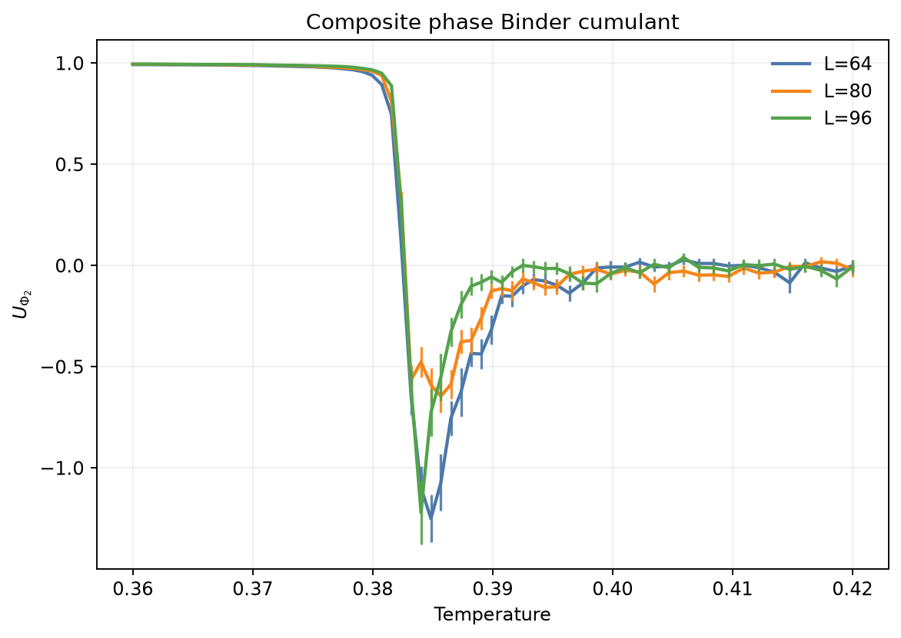
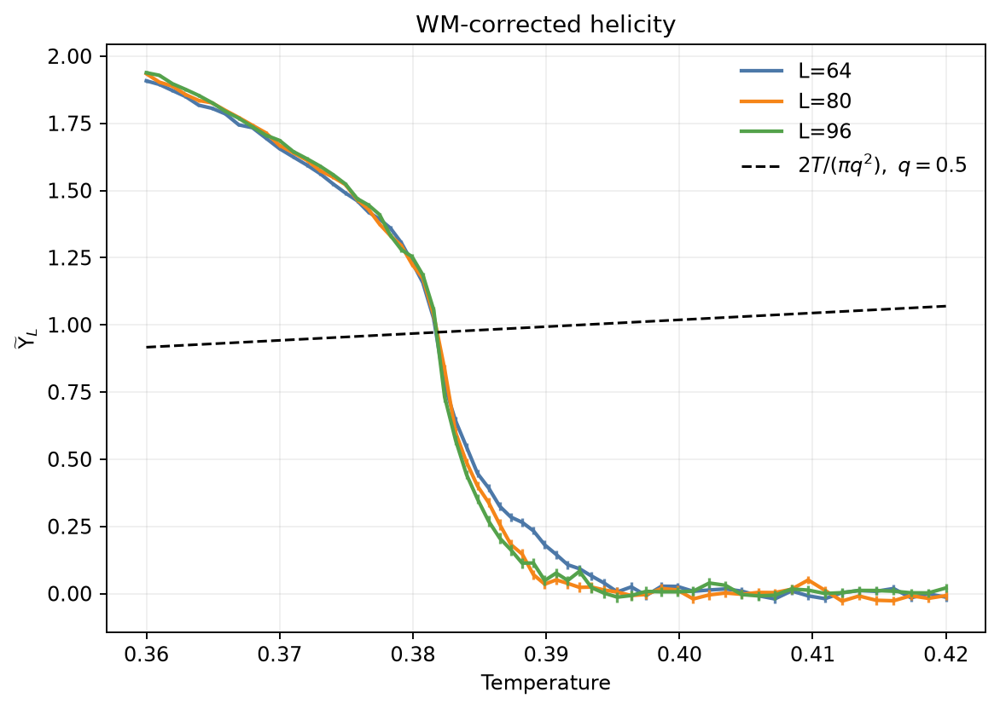
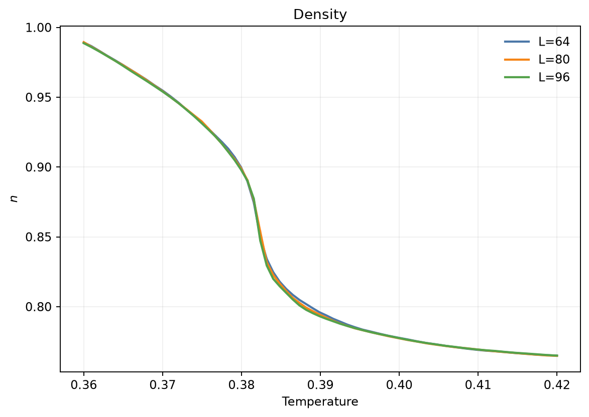
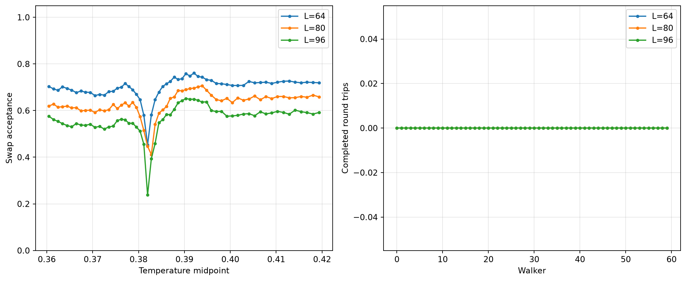
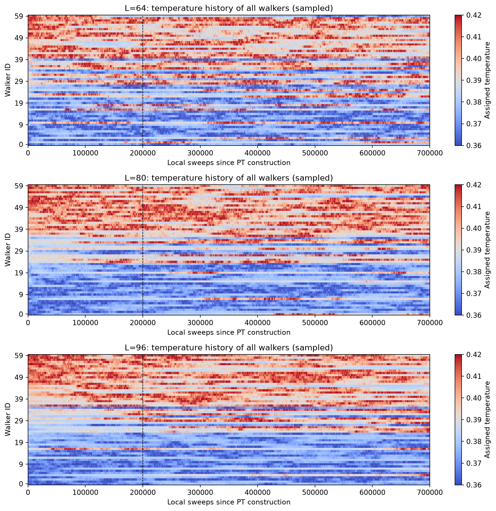

# Full Thin-Film He3 Analysis

**Data:** `data/he3_run.npz`
**System sizes:** [64, 80, 96]
**Block size:** 200
**Vortex charge hypothesis:** $q = 0.5$

## Weber–Minnhagen Fit

- Critical temperature: $T_{BKT} = 0.381771$
- Correction constant: $C = -1.988596$
- Reduced chi-square: 1.731

The helicity modulus is rescaled using:

$$
\widetilde{\Upsilon}_L(T) = \frac{\Upsilon_L(T)}{1 + 1/(2\ln L+C)}
$$

The corresponding candidate universal jump is:

$$
\Upsilon(T_{BKT}^-) = \frac{2T_{BKT}}{\pi (0.5)^2}
$$

The WM fit is exploratory. The chirality Binder cumulants are inspected visually without fitting their crossings.

## Binder Chirality



## Binder Phase



## Helicity



## Density



## Parallel Tempering



## Walker Temperature History



## Parallel Tempering Summary

```text
Parallel tempering diagnostics (including thermalization)
Trip means exclude unfinished trips; zero trips does not imply zero one-way crossings.
L=64: 288635/413000 accepted, 0 trips, mean None sweeps/trip
  walker paths recorded
L=80: 259825/413000 accepted, 0 trips, mean None sweeps/trip
  walker paths recorded
L=96: 232900/413000 accepted, 0 trips, mean None sweeps/trip
  walker paths recorded
```
