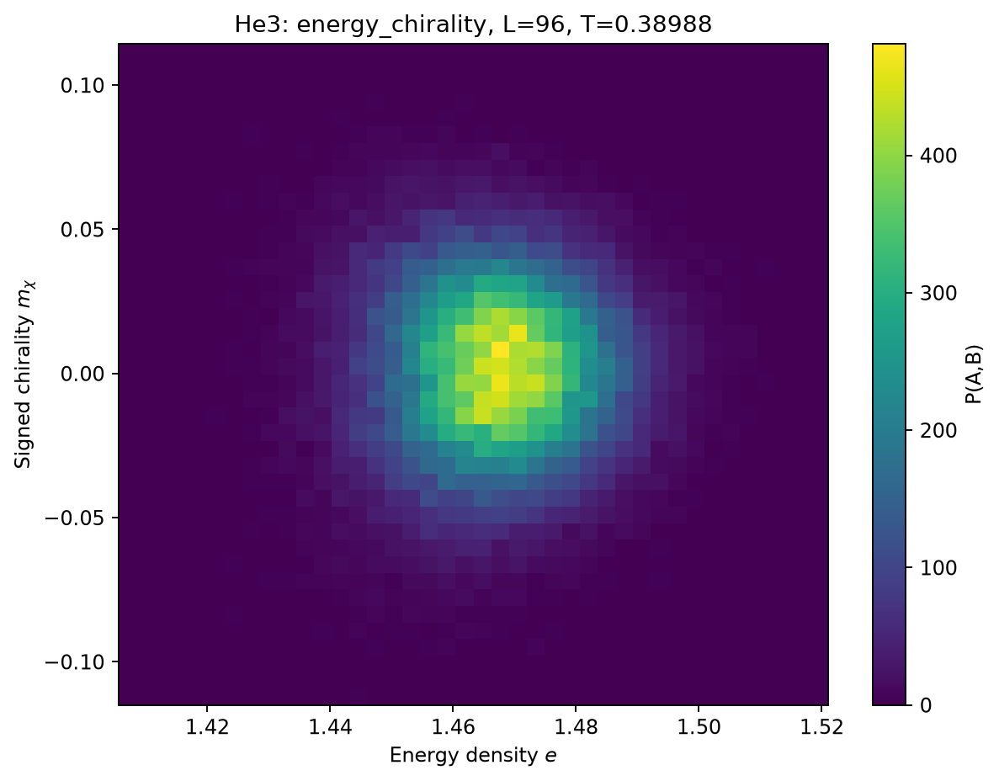
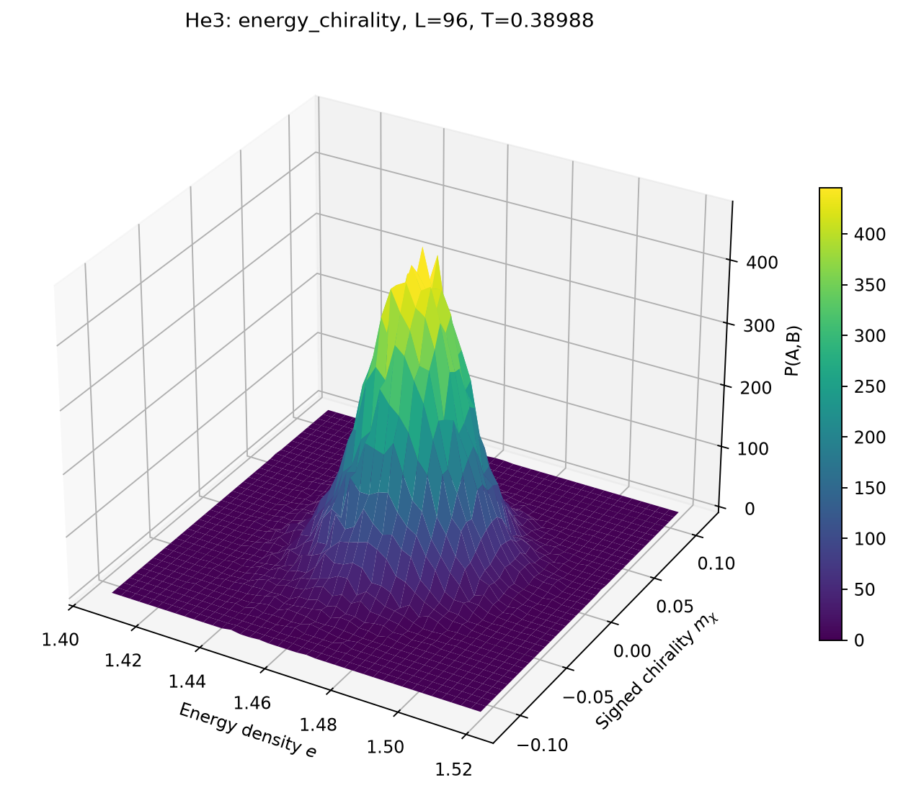
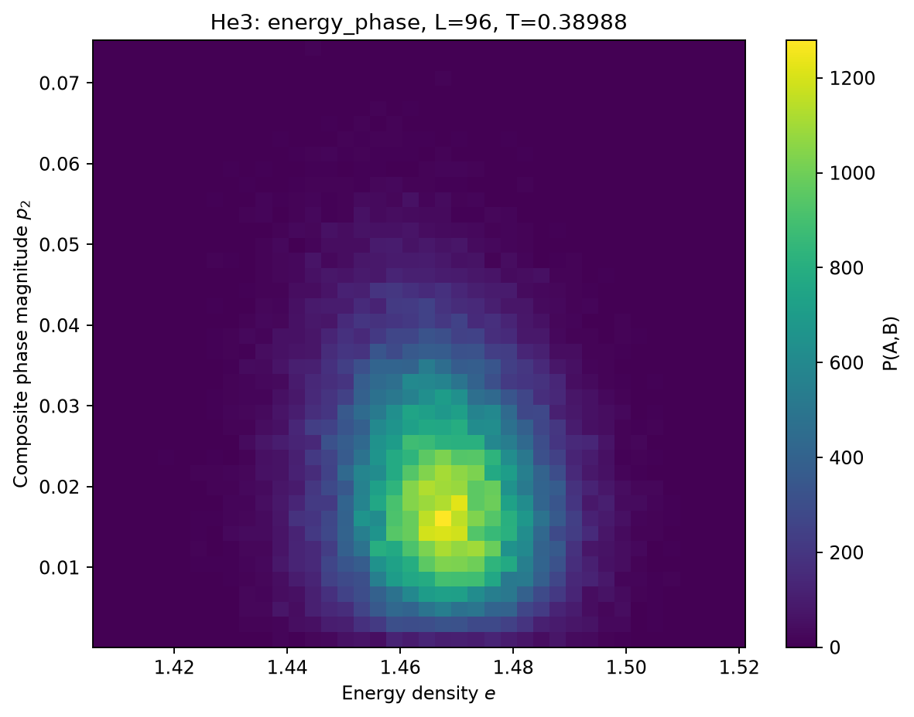
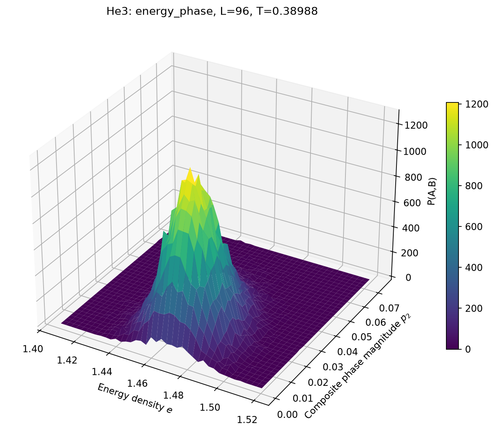

# Full Thin-Film He3 Analysis

**Data:** `data/he3_run.npz`
**System sizes:** [64, 80, 96]
**Block size:** 200
**Vortex charge hypothesis:** $q = 0.5$

## Weber–Minnhagen Fit

- Critical temperature: $T_{BKT} = 0.381080$
- Correction constant: $C = -5.514298$
- Reduced chi-square: 9.556

The helicity modulus is rescaled using:

$$
\widetilde{\Upsilon}_L(T) = \frac{\Upsilon_L(T)}{1 + 1/(2\ln L+C)}
$$

The corresponding candidate universal jump is:

$$
\Upsilon(T_{BKT}^-) = \frac{2T_{BKT}}{\pi (0.5)^2}
$$

The WM fit is exploratory. The chirality Binder cumulants are inspected visually without fitting their crossings.

## Binder Chirality


## Binder Phase


## Helicity


## Density


## Joint L96 Energy Chirality Joint Heatmap



## Joint L96 Energy Chirality Joint Surface



## Joint L96 Energy Phase Joint Heatmap



## Joint L96 Energy Phase Joint Surface



## Parallel Tempering


## Walker Temperature History


## Parallel Tempering Summary

```text
Parallel tempering diagnostics (including thermalization)
Trip means exclude unfinished trips; zero trips does not imply zero one-way crossings.
L=64: 3342307/3960000 accepted, 3 trips, mean 693846.6666666666 sweeps/trip
  walker paths recorded
L=80: 3193624/3960000 accepted, 0 trips, mean None sweeps/trip
  walker paths recorded
L=96: 3046254/3960000 accepted, 0 trips, mean None sweeps/trip
  walker paths recorded
```
