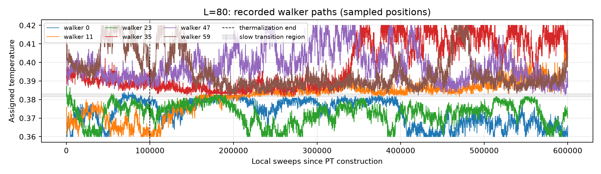
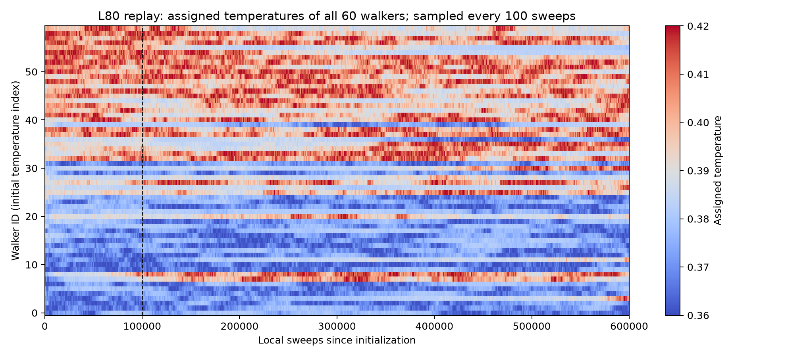
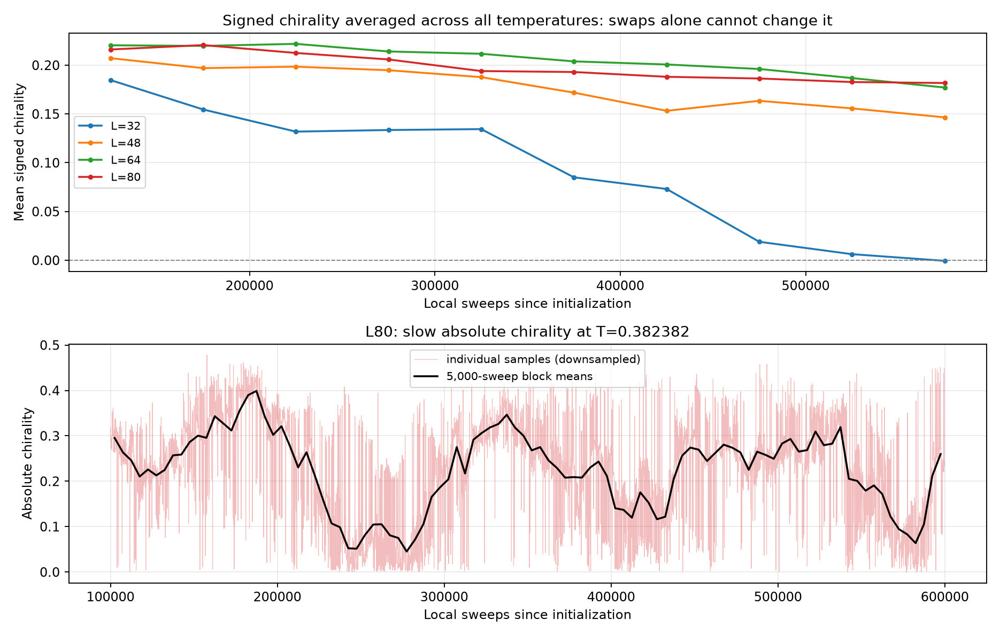

# Why swaps look good but round trips are rare

The current He3 run has good local exchange acceptance and poor global walker
transport. No error was found in the round-trip counter, swap sign, inverse
mappings, or energy-cache ordering. The main problem is persistent configuration
memory and correlated exchanges near the transition.

All sizes used 60 temperatures from 0.36 to 0.42, 100,000 thermalization and
500,000 measurement sweeps, with exchanges every 10 sweeps. Statistics include
thermalization: 60,000 exchange rounds and 30,000 attempts per edge.

| L | Aggregate acceptance | Minimum edge acceptance | Completed trips | Walkers with no completed trip |
|---|---:|---:|---:|---:|
| 32 | 84.5% | 80.4% | 30 | 34/60 |
| 48 | 77.1% | 63.6% | 1 | 59/60 |
| 64 | 69.9% | 56.0% | 0 | 60/60 |
| 80 | 62.9% | 40.5% | 0 | 60/60 |

The weakest edges lie around T=0.3816-0.3832. They are frequently crossed;
there is no nearly closed temperature edge in this run.

**What the paths show.** The old file has no trajectory history. A separate
600,000-sweep L80 replay used its exact coefficients, initialization seed,
exchange seed, temperature ladder, and update schedule, with optional recording.
Every saved per-edge acceptance count, both final mappings, and all round-trip
counts/durations match the original exactly. The plots come from this matching
replay, rather than an attempt to infer paths from aggregate counters.

Walker 0 was observed between T=0.36 and 0.3840; walker 59 between 0.3824 and
0.42. Other walkers occasionally move between these broad regions, but the
ensemble retains substantial memory of which end it started near. The median
sampled temperature-index span is 33 out of 59. These are observed ranges at
100-sweep resolution: short excursions between records can be missed. The exact
GPU trip counters, evaluated after every exchange, do not have that limitation.

**Why high acceptance does not imply mixing.** An accepted exchange counts a
local temperature-label move, including a move that is soon reversed. The
acceptance plot averages over walkers and the entire run, discarding the order
and correlations of those moves. Long-distance transport requires persistent
progress and sufficient physical relaxation as the walker changes temperature.

The implementation's alternating matching schedule makes this distinction easy
to demonstrate. Repeating accepted/rejected rounds [all, all, none, all, all,
none] gives every edge 2/3 acceptance, while walker permutations return to the
identity every six rounds and never complete the ladder. This is an illustrative
counterexample, not a model fitted to the He3 trajectory.

An independent check of the actual exchange-kernel body, for replica counts
2, 3, 4, 7, 60 and 259 over 2,000 rounds each, matched independently counted
endpoint histories and durations. A completed trip means first endpoint ->
opposite endpoint -> original endpoint. An interior walker starts timing only
when it first reaches an endpoint. Zero completed trips does not imply zero
one-way endpoint traversals.

The importance of measuring transport rather than just average acceptance is
also discussed in [Katzgraber et al., Feedback-optimized parallel tempering Monte
Carlo](https://arxiv.org/abs/cond-mat/0602085).

**Physical memory is visible in the original observations too.** The signed
chirality averaged over all temperature slots is unchanged by any permutation
of those slots. Its continued relaxation therefore reflects physical evolution,
not merely movement of temperature labels. In the first/last 50,000-sweep
measurement blocks, this mean changes from about .220 to .177 at L64, and .216
to .182 at L80. The corresponding L32 mean reaches approximately zero.

The L80 absolute chirality around T=0.382382 also fluctuates on tens of thousands
of sweeps. These observations support slow structural relaxation and correlated
backtracking. They do not establish a first-order transition or prove every
observable is biased. In particular, remaining in one chirality sign sector
alone need not bias observables that are even under chirality reversal.

**What changed in the code.**

- ParallelTempering can optionally record selected walker positions on the GPU.
  Recording uses growing chunks, with no history transfers to the CPU during
  exchanges. Physical updates, exchange decisions and RNG sequences are unchanged.
- `tracked_walkers=None` disables recording. `history_stride` counts exchange
  rounds. The initial and final positions are included, and exact sweep/round
  coordinates are saved under `parallel_tempering.walker_history`.
- `main/he3.py` now records all walkers every ten exchange rounds: one point
  per 100 local sweeps at the current exchange interval.
- PTAnalysis retains the swap and round-trip reports. Trip means explicitly
  exclude unfinished journeys, so a mean based on just one completed trip must
  not be interpreted as the average mixing time of all walkers.
- `plot_walkers()` produces a temperature-history heatmap of all recorded
  walkers. Old files without histories produce no substitute plot.
  `analysis/he3.py` exports this as `walker_temperature_history.png`, the only
  additional diagnostic alongside the existing swap and round-trip figure.

Focused verification passed 29 tests: 7 CPU analysis tests, 5 GPU recording
tests, 10 existing exchange tests, and 7 cache tests. Tests cover chunk rollover,
recording stride, manual exchanges at the same sweep, final snapshots,
save/reload, input validation, missing histories and recorded walker ordering.

**Next experiments.** Do not add replicas simply to raise acceptance that is
already high. Compare short pilots using exchange intervals 10, 50 and 100 and
judge completed transport and physical-observable autocorrelation per unit
wall time. A longer local interval may reduce correlated reversals, but is not
guaranteed to improve overall efficiency. Test a higher hot endpoint, for
example .45, while checking that the order parameter loses initial-state
memory; a dense grid around the transition alone does not ensure that.
Compare independent ordered and disordered starts and extend equilibration
until block means stabilize. Keep any adaptation in pilot runs, then freeze
the production ladder and schedule.

Artifacts: [matching replay dataset](recorded_replay.npz),
[numerical diagnosis](diagnosis.json), [swap/trip plot](swap_and_roundtrips.png),
[original final positions](original_final_positions.png), and
[text summary](summary.txt). The original production dataset was not modified.
