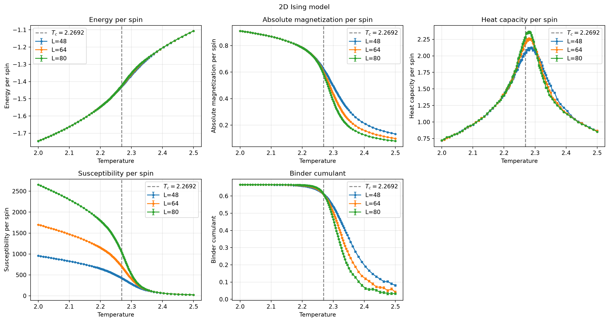
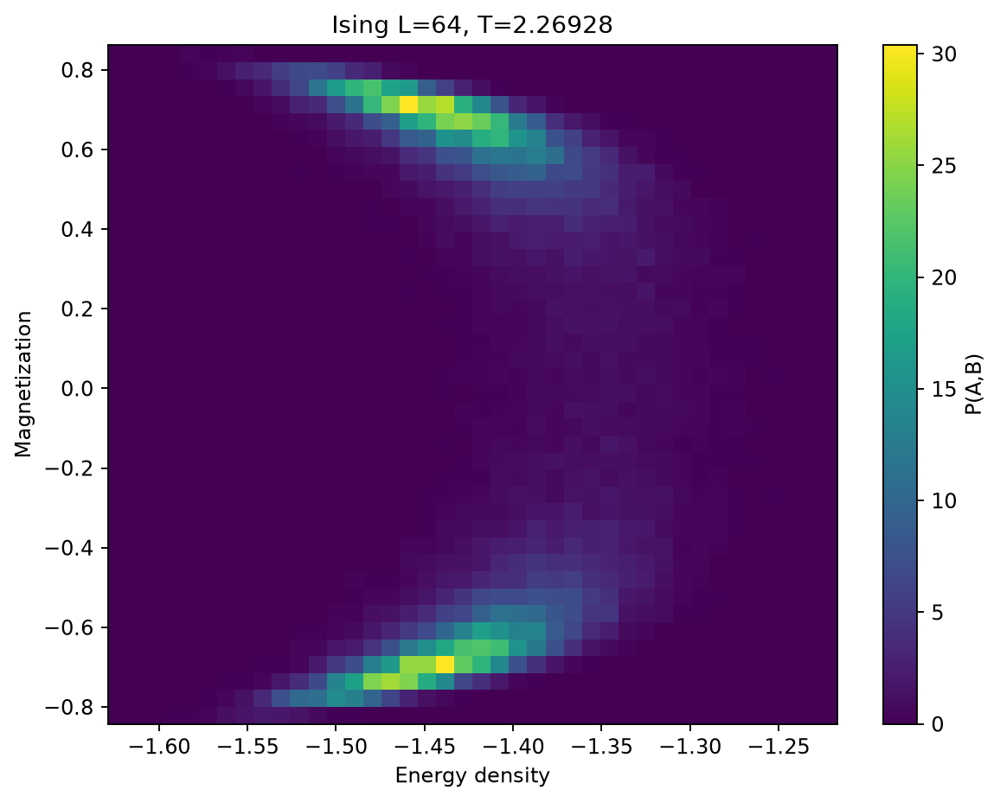
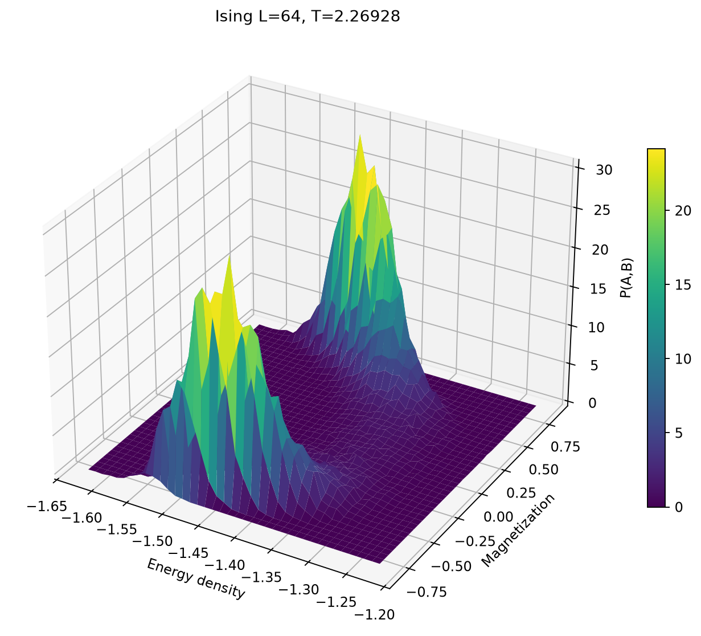
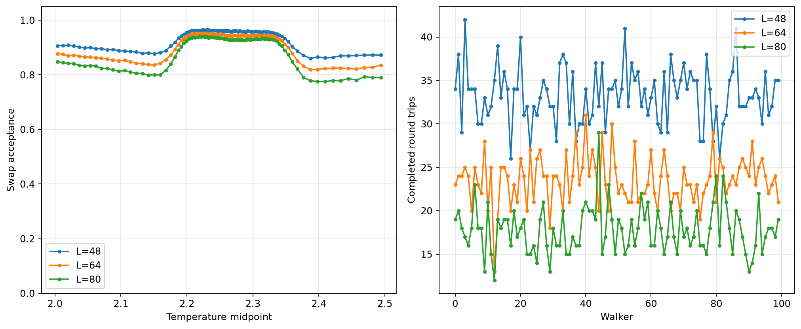

# Ising Analysis

**Data:** `data/ising_run.npz`
**System sizes:** [48, 64, 80]
**Block size:** 200

## Ising Observables



## Joint Heatmap



## Joint Surface



## Parallel Tempering



## Parallel Tempering Summary

```text
Parallel tempering diagnostics (including thermalization)
Trip means exclude unfinished trips; zero trips does not imply zero one-way crossings.
L=48: 2768880/2970000 accepted, 3327 trips, mean 17588.662458671475 sweeps/trip
  walker paths were not recorded; final mappings cannot reconstruct trajectories
L=64: 2701910/2970000 accepted, 2349 trips, mean 24748.446147296723 sweeps/trip
  walker paths were not recorded; final mappings cannot reconstruct trajectories
L=80: 2636336/2970000 accepted, 1779 trips, mean 32205.182686902754 sweeps/trip
  walker paths were not recorded; final mappings cannot reconstruct trajectories
```
