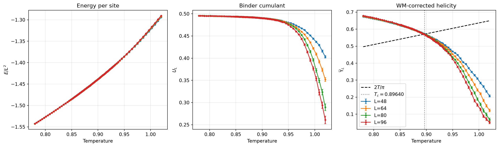
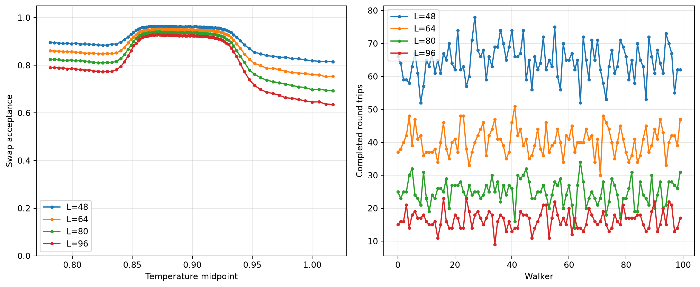

# XY Analysis

**Data:** `data/xy_run.npz`
**System sizes:** [48, 64, 80, 96]
**Block size:** 200

## Weber–Minnhagen Fit

- Critical temperature: $T_c = 0.896404$
- Correction constant: $C = 3.641744$
- Reduced chi-square: 2.738

The helicity modulus is rescaled using:

$$\widetilde{\Upsilon}_L(T) = \frac{\Upsilon_L(T)}{1 + 1/(2\ln L+C)}$$

## Xy Observables



## Parallel Tempering



## Parallel Tempering Summary

```text
Parallel tempering diagnostics (includes thermalization)
L=48: 6878202/7425000 accepted, 6456 trips, mean 22952.159231722428 sweeps/trip
L=64: 6696279/7425000 accepted, 4033 trips, mean 36397.892387800646 sweeps/trip
L=80: 6515842/7425000 accepted, 2495 trips, mean 57991.03006012024 sweeps/trip
L=96: 6338415/7425000 accepted, 1644 trips, mean 86892.79805352798 sweeps/trip
```
